<h1 align="center">Olá, eu sou o Vinicius Mendes! 👋</h1>

<h3 align="center">Desenvolvedor Backend em formação | Java • Spring Boot • Python</h3>

  
  
  

### 👨‍💻 Sobre mim

- 🎓 Graduando em **Ciência da Computação na UFMT — Campus do Araguaia** (2024–2028).
- ☕ Foco em **desenvolvimento backend com Java, Spring Boot e bancos de dados relacionais**.
- 🐍 Também desenvolvo projetos com **Python**, algoritmos e automação.
- 🐧 Tenho experiência prática com **Linux, Docker, redes e administração de servidores** em laboratório próprio.
- 🎯 Busco oportunidades de **estágio em Desenvolvimento Backend ou Engenharia de Software**.

### 🛠️ Tecnologias

**Backend e banco de dados**

  
  &nbsp;
  
  &nbsp;
  
  &nbsp;
  

**Ferramentas e infraestrutura**

  
  &nbsp;
  
  &nbsp;
  

**Outros conhecimentos**

  
  &nbsp;
  
  &nbsp;
  

### 🚀 Experiência prática e projetos

- **Sistema de controle de frotas:** desenvolvimento acadêmico com **Java, Spring Boot, MySQL e React**, trabalhando com persistência de dados e integração entre aplicação e banco.
- **Homelab e servidores Linux:** configuração e manutenção de serviços com **Debian, Docker, CasaOS, DNS e acesso remoto**, além de diagnóstico de problemas de rede.
- **Algoritmos e processamento de dados:** projetos acadêmicos com **Python, C e C++**, estruturas de dados, ordenação e processamento digital de imagens.

📁 **[Explore meus repositórios no GitHub](https://github.com/Vsmendz?tab=repositories)**

### 📊 Atividade no GitHub

  
  

---

💡 Sempre aprendendo, construindo e evoluindo como desenvolvedor.

